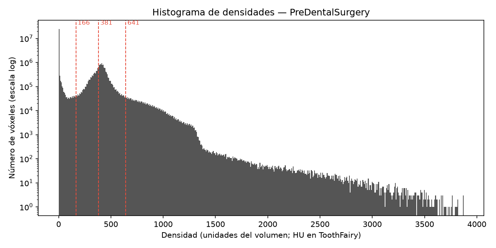
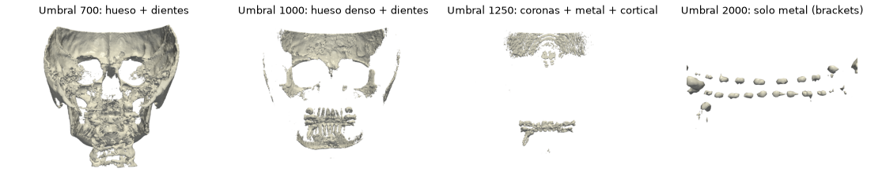

# Rangos de densidad por estructura

Responsables: Nicolás (literatura y datos) y Emanuel (lo que se ve en el render).
Alimenta `RANGOS_DENSIDAD` en `src/densidades.py`, que hoy está vacío. Revisado el
15/10/2026.

## 1. Qué es un "rango de densidad" y cómo lo usa el programa

Cada vóxel de la tomografía guarda un número: su **densidad**, es decir, cuánto
frena los rayos X el material que hay en ese punto. El aire frena poco, la piel
algo más, el hueso bastante y el esmalte dental es lo más denso del cuerpo. El metal
de una corona o de un bracket frena todavía más.

La vista 3D tiene una **barra de umbral**. Todo lo que tenga densidad **mayor o
igual** al umbral se dibuja; lo demás se vuelve invisible. Un **preset** (por
ejemplo "dientes") es un atajo que mueve la barra al valor que deja ver esa
estructura. `RANGOS_DENSIDAD` guarda esos valores como `(mínimo, máximo)`:

- el **mínimo** es el valor que se pone en la barra;
- el **máximo** sirve si se quiere quitar lo más denso (por ejemplo, ver la dentina
  sin el esmalte). Para eso hay que filtrar antes con
  `malla.threshold((mínimo, máximo), scalars="densidad")`. Por ahora todos los
  presets usan máximo = infinito.

**El problema central:** los números dependen del equipo. En un CT médico están
calibrados en **unidades Hounsfield (HU)** (aire = −1000, agua = 0), pero en un CBCT
dental cada equipo da números distintos para la misma anatomía (ver
[marco-teorico.md §4](marco-teorico.md#4-unidades-hounsfield-y-por-qué-el-cbct-no-está-calibrado)).
Por eso hay **dos juegos de rangos**, uno por cada dataset del proyecto
([datasets.md](datasets.md)).

## 2. Los rangos que se usan

### 2.1 Para la muestra de 3D Slicer (demo del 26/10) — medidos

Valores en las unidades de ese equipo (no HU), comprobados mirando el render el
15/10 (detalle en la §4):

```python
INF = float("inf")

RANGOS_DENSIDAD_MUESTRA_SLICER = {
    "hueso":   (700, INF),    # cráneo, maxilares y dientes
    "dientes": (1000, INF),   # hueso más denso + dientes con sus raíces
    "esmalte": (1250, INF),   # coronas; también brackets y algo de hueso cortical
    "metal":   (2000, INF),   # solo los brackets de ortodoncia
}
```

### 2.2 Para ToothFairy3 (informe) — propuesta en HU, falta validar

Basada en la literatura (§3). Se valida midiendo las etiquetas de ToothFairy3 con el
método de la §5:

```python
RANGOS_DENSIDAD = {
    # nombre: (mínimo, máximo) en HU. Propuesta de investigación; validar con docs/investigacion/densidades.md §5
    "tejido_blando": (-200, 150),     # encía, lengua, músculo; ruidoso en CBCT
    "hueso":         (150, INF),      # todo el hueso + dientes ("mandíbula completa")
    "hueso_denso":   (850, INF),      # hueso cortical (Misch D1–D2) + dientes
    "dientes":       (1300, INF),     # dentina + esmalte (y restauraciones)
    "esmalte":       (2000, INF),     # coronas (y metal o resinas radiopacas)
}
```

Comparando las dos tablas se ve el problema central: en la muestra de Slicer, 2000
deja **solo metal**; en HU, 2000 debería dejar el esmalte.

## 3. Lo que dice la literatura (valores en HU)

Estos valores son de **CT médico calibrado**. En CBCT solo se pueden comparar si el
dataset está normalizado a Hounsfield, como ToothFairy3.

| Estructura | Valores reportados | Fuente |
|---|---|---|
| Aire | −1000 HU | Definición de la escala Hounsfield |
| Agua | 0 HU | Definición de la escala Hounsfield |
| Pulpa dental | medias de 184 a 420 HU según el diente | Reshetnikov et al. 2024 [1] |
| Hueso trabecular (esponjoso) | Misch D4: 150–350 HU · D3: 350–850 HU | Clasificación de Misch [2] |
| Hueso maxilar en sitios de implante | medias: maxilar posterior 486, mandíbula posterior 628, maxilar anterior 641, mandíbula anterior 844 HU | Hiasa et al. 2011 [3] |
| Hueso cortical / denso | Misch D2: 850–1250 HU · D1: > 1250 HU | Misch [2] |
| Dentina | medias de 1323 a 1899 HU según el diente | Reshetnikov et al. 2024 [1] |
| Esmalte | medias de 2071 a 2955 HU según el diente | Reshetnikov et al. 2024 [1] |
| Resinas radiopacas y metal | ≥ esmalte; en CT las resinas llegaron al tope del equipo (4000 HU) y era difícil separarlas del esmalte | Sakuma et al. 2012 [4] |

**Cómo salen los rangos de la §2.2:**

| Preset | Mínimo | Justificación |
|---|---|---|
| tejido_blando | −200 a 150 | Alrededor del agua (0 HU); se deja margen por el ruido del CBCT |
| hueso | 150 | Límite inferior del hueso trabecular menos denso (Misch D4) |
| hueso_denso | 850 | Límite de Misch entre D3 y D2: queda el hueso compacto |
| dientes | 1300 | Por debajo de la dentina menos densa (1323 HU) |
| esmalte | 2000 | Por debajo del esmalte menos denso (2071 HU) y por encima de la dentina (≤ 1899 HU) |

**Advertencias:**

- Reshetnikov et al. midieron en **niños de 10–11 años**; los dientes adultos pueden
  ser un poco distintos.
- La clasificación de Misch se pensó para evaluar hueso antes de un implante, no
  para segmentar. Se usa como orden de magnitud.
- Hay **solapamientos reales**: el hueso cortical muy denso (> 1250 HU) se cruza con
  la dentina (1300–1900 HU), y el esmalte con las restauraciones. Ningún umbral
  único los separa (§6).

## 4. Rangos medidos en la muestra de 3D Slicer

El 15/10/2026 se corrió `scripts/histograma_densidades.py` sobre
`PreDentalSurgery.gipl.gz` y se dibujó la superficie en varios umbrales con el
código del proyecto (`src/render_3d.a_pyvista` + `contour`, `reduccion=2`).

**Histograma:** cuántos vóxeles hay de cada densidad, con el eje vertical en escala
logarítmica.



Cómo leerlo:

- el pico alto en 0 es el **aire** alrededor de la cabeza;
- el pico ancho cerca de 400 es la **piel y el tejido blando**;
- la "cola" que baja de 600 a ~1300 es el **hueso** y los **dientes**;
- lo poco que queda por encima de ~1400 es **esmalte y metal**.

Las líneas rojas son los umbrales automáticos de Otsu (ver §5).

**Superficie 3D en cuatro umbrales:**



| Umbral | Qué queda visible | Triángulos |
|---|---|---|
| ~400 | Piel y tejido blando, muy ruidoso. La figura no se publica porque muestra la cara del paciente | 2 323 020 |
| 700 | Cráneo, maxilares y dientes | 325 652 |
| 1000 | Hueso denso + dientes con sus raíces | 96 640 |
| 1250 | Coronas (esmalte), brackets y parte del hueso del cráneo | 25 868 |
| 2000 | **Solo metal**: los brackets de ortodoncia | 2 548 |

**Hallazgos:**

1. **Los valores no están en Hounsfield.** Van de 0 a 3874 y el aire vale 0, no
   −1000. Los rangos en HU de la §2.2 no sirven tal cual para este equipo.
2. **El metal supera al esmalte.** Por encima de ~2000 solo quedan los brackets. En
   el corte axial se ven en rojo sobre la cara externa de los dientes:
   [corte_axial_brackets.png](../../results/investigacion/corte_axial_brackets.png).
3. **Solapamiento hueso–esmalte.** En 1250 aparecen a la vez las coronas y zonas del
   hueso del cráneo, así que un solo umbral no da "solo esmalte".
4. **Otsu no encuentra los dientes.** Los umbrales automáticos (166, 381, 641)
   separan aire, piel y tejido blando, porque esas clases tienen millones de
   vóxeles y los dientes son menos del 1 % del volumen. Para presets automáticos de
   hueso y dientes funcionan mejor los **percentiles altos**: p99 ≈ 874 (hueso),
   p99.5 ≈ 994 (hueso denso y dientes), p99.9 ≈ 1232 (coronas). Coinciden con los
   umbrales elegidos mirando el render.

## 5. Cómo validar los rangos en HU con ToothFairy3 (Fase 2)

Script: `scripts/histograma_densidades.py`. Para cada uno de 3–5 estudios:

1. **Histograma** (`results/histograma_<estudio>.png`). En HU se esperan picos en el
   aire (≈ −1000) y el tejido blando (≈ 0), y una cola de hueso y dientes.
2. **Umbrales automáticos.** Otsu multinivel separa bien aire, piel y tejido
   blando. Para hueso y dientes, mirar los percentiles altos que imprime el script.
3. **Densidad por estructura** (`--etiquetas`). Para cada estructura etiquetada
   (mandíbula, maxilar, cada diente, cada pulpa, conducto), el script calcula los
   percentiles 5, 25, 50, 75 y 95 y los guarda en
   `results/densidad_por_etiqueta_<estudio>.csv`. **Es la evidencia más fuerte para
   el informe:** el rango de cada preset puede ir, por ejemplo, del percentil 5 al
   95 de esa estructura en todos los estudios.
   - Las etiquetas de diente cubren el diente entero (esmalte + dentina); la pulpa
     viene aparte. Para el esmalte, usar la parte alta de la distribución del
     diente (por encima del percentil 75) y confirmarlo en el visor 2D.
4. **Mirar el resultado.** Emanuel aplica cada rango en el render y guarda una
   captura en `results/preset_<nombre>.png`.

```bash
python scripts/histograma_densidades.py data/raw/ToothFairy3/imagesTr/P001_0000.nii.gz \
    --etiquetas data/raw/ToothFairy3/labelsTr/P001.nii.gz \
    --dataset-json data/raw/ToothFairy3/dataset.json
```

Los nombres de las carpetas dependen de cómo venga la descarga.

**Tabla final** (formato del plan: rango → fuente o evidencia → captura):

| Preset | Rango final (HU) | Literatura | Medido en ToothFairy3 (p5–p95, n estudios) | Captura |
|---|---|---|---|---|
| tejido_blando | | Definición HU | | `results/preset_tejido_blando.png` |
| hueso | | Misch D4–D1 [2], Hiasa [3] | | `results/preset_hueso.png` |
| hueso_denso | | Misch D1–D2 [2] | | `results/preset_hueso_denso.png` |
| dientes | | Reshetnikov [1] | | `results/preset_dientes.png` |
| esmalte | | Reshetnikov [1] | | `results/preset_esmalte.png` |

## 6. Limitaciones (van en el informe)

1. **CBCT no calibrado.** Los rangos en HU valen para datos normalizados como
   ToothFairy3. Con otros equipos hay que usar presets relativos a cada estudio
   (percentiles), como en la muestra de Slicer.
2. **Solapamiento.** El hueso cortical denso se parece a la dentina, y el esmalte al
   metal o a la resina. La umbralización sola no los separa; haría falta
   segmentación por forma o aprendizaje automático, que es justo para lo que se
   creó ToothFairy.
3. **Volumen parcial.** En los bordes, un vóxel mezcla dos tejidos y queda con un
   valor intermedio, así que el esmalte delgado del borde puede caer en el rango de
   la dentina.
4. **Artefactos de metal.** Las rayas que produce el metal generan superficies
   falsas en todos los presets altos.

## Referencias

1. Reshetnikov A., Shaikhattarova N., Mazurok M., Kasatkina N. (2024). Dental tissue
   density in healthy children based on radiological data: retrospective analysis.
   *JMIRx Med*, 5, e56759. https://doi.org/10.2196/56759
2. Misch C.E. (2008). *Contemporary Implant Dentistry* (3.ª ed.). Mosby. Rangos en HU
   de las clases D1–D4.
3. Hiasa K., Abe Y., Okazaki Y., Nogami K., Mizumachi W., Akagawa Y. (2011).
   Preoperative computed tomography-derived bone densities in Hounsfield units at
   implant sites acquired primary stability. *ISRN Dentistry*, 2011, 678729.
   https://doi.org/10.5402/2011/678729
4. Sakuma A., Saitoh H., Makino Y., Inokuchi G., Hayakawa M., Yajima D., Iwase H.
   (2012). Three-dimensional visualization of composite fillings for dental
   identification using CT images. *Dentomaxillofacial Radiology*, 41(6), 515–519.
   https://doi.org/10.1259/dmfr/13441277
