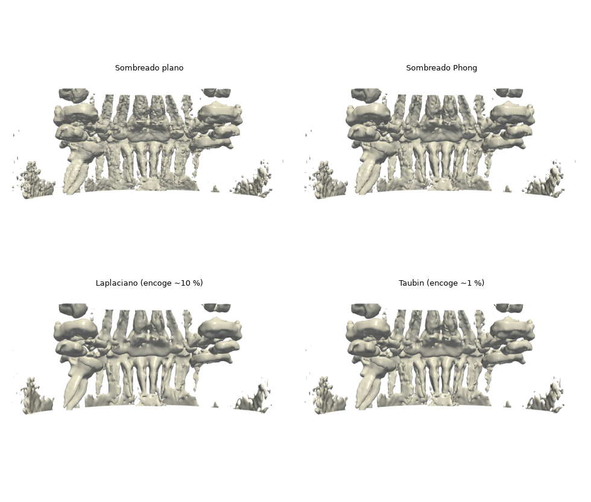

# Preguntas clave de la propuesta — respuestas para la exposición

Responsable: Nicolás. Son las cinco preguntas de la propuesta que el profesor
Paluszny puede hacer en la exposición del **26 de octubre**. Cada una tiene:

- una **respuesta corta** (≈ 30 s, para decir en voz alta);
- la **explicación** por si piden más detalle;
- **cómo se hace en el proyecto** (PyVista/VTK);
- qué **mostrar en la demo**.

Lo de PyVista se verificó en el código fuente de PyVista 0.49 y se **probó** con un
CBCT dental real (la muestra de 3D Slicer, ver [datasets.md](datasets.md)). Los
números medidos están en cada pregunta.
Teoría de fondo: [marco-teorico.md](marco-teorico.md).

---

## 1. ¿Cómo se traduce la escala de grises (unidades Hounsfield) en una malla 3D?

**Respuesta corta.** "El archivo trae números crudos por vóxel; con la pendiente y
el intercepto del DICOM los pasamos a densidad. El usuario elige un umbral con la
barra, y el algoritmo **marching cubes** recorre el volumen de 8 en 8 vóxeles: en
cada cubito mira qué esquinas quedan por encima y por debajo del umbral, y según una
tabla de 15 casos pone triángulos justo donde la densidad cruza ese valor. El
resultado es una malla de triángulos, la isosuperficie, que la tarjeta gráfica
dibuja e ilumina."

**Paso a paso (pipeline del proyecto):**

| # | Paso | Dónde |
|---|---|---|
| 1 | Leer cortes y ordenarlos por z | `carga.py` |
| 2 | Valor guardado → densidad: `valor × RescaleSlope + RescaleIntercept` | `carga.py` |
| 3 | Volumen `(z, y, x)` + tamaño del vóxel `(dz, dy, dx)` en mm → rejilla `pv.ImageData` | `render_3d.a_pyvista` |
| 4 | El usuario fija el **isovalor** (umbral) con la barra o un preset | `add_slider_widget` |
| 5 | **Marching cubes:** 8 esquinas → 2⁸ = 256 casos → 15 configuraciones por simetría; vértices por **interpolación lineal** sobre las aristas | `malla.contour([umbral])` |
| 6 | **Normales** por vértice (gradiente de la densidad) para iluminar | `compute_normals` / `smooth_shading` |
| 7 | La GPU rasteriza los triángulos con el modelo de iluminación | VTK/OpenGL |

**Matices que suman puntos:**

- La interpolación lineal hace que la superficie quede **entre** vóxeles, no en sus
  bordes. Por eso la malla es más suave que "pintar cubitos" (vóxeles opacos).
- En CBCT los grises **no son HU verdaderas** (varían entre equipos). El dataset
  ToothFairy los entrega normalizados a HU, por eso ahí un umbral fijo funciona
  (Pauwels et al. 2015).
- PyVista permite tres algoritmos: `method='contour'` (por defecto,
  `vtkContourFilter`), `'marching_cubes'` (`vtkMarchingCubes`) y `'flying_edges'`
  (`vtkFlyingEdges3D`, más rápido y multihilo). Ver la pregunta 3.
- Hay otra forma de ver el volumen sin malla: el **renderizado volumétrico
  directo** (`add_volume`), que acumula color y opacidad a lo largo de rayos. No da
  una malla exportable.

**Demo:** mover la barra de umbral. Con la muestra CBCT de 3D Slicer (que **no**
está en HU) se probó así:
- 700: cráneo, maxilares y dientes;
- 1000: hueso denso y dientes con raíces;
- 1250: coronas;
- 2000: solo los brackets de metal.

En ToothFairy3 (sí está en HU) los valores esperados son ~150, ~1300 y ~2000
([densidades.md](densidades.md)).


---

## 2. ¿Qué técnicas de iluminación (sombras, Phong/Gouraud) ayudan a distinguir irregularidades del hueso o de las raíces?

**Respuesta corta.** "La forma 3D se percibe por cómo cambia la luz sobre la
superficie, y eso depende de las **normales**. Con sombreado plano cada triángulo
tiene un solo tono y se ven las facetas. Con **Gouraud** se calcula la luz en los
vértices y se interpolan los colores, pero los brillos pequeños se pierden. Con
**Phong** se interpolan las normales y se calcula la luz en cada píxel, así que los
brillos especulares marcan bien las curvaturas finas, como una raíz o una
irregularidad del hueso. Usamos Phong con un poco de especular, y oclusión ambiental
para oscurecer las cavidades y dar profundidad."

**Explicación.** Hay que separar dos ideas que suelen confundirse:

1. **Modelo de iluminación de Phong** (qué color tiene un punto):
   `color = ambiente + difusa·(N·L) + especular·(R·V)^n`
   - *Ambiente*: luz base.
   - *Difusa* (Lambert): depende del ángulo entre la normal **N** y la luz **L**;
     da la forma.
   - *Especular*: brillo que depende de la dirección de vista **V**. El exponente
     *n* (`specular_power`) controla qué tan concentrado es el brillo.
2. **Interpolación del sombreado** (dónde se evalúa ese modelo):

| Técnica | Cómo | Ventaja | Desventaja |
|---|---|---|---|
| **Plano (flat)** | Una normal por triángulo | Se ven los triángulos reales: útil para explicar marching cubes | Aspecto facetado |
| **Gouraud** (1971) | Luz en los vértices, se interpolan los colores | Barato | Brillos borrosos o perdidos dentro de triángulos grandes |
| **Phong** (1975) | Se interpolan las normales y la luz se calcula por píxel | Brillos nítidos; muestra curvaturas finas | Más cálculo (trivial en GPU moderna) |

**Más allá del sombreado local:**

- **Sombras** (`pl.enable_shadows()`): una estructura proyecta sombra sobre otra.
  Ayuda a ver qué está delante, pero puede confundir y cuesta rendimiento.
- **Oclusión ambiental en pantalla, SSAO** (`pl.enable_ssao()`): oscurece las zonas
  hundidas (entre raíces, alvéolos, conductos), donde llega menos luz. Es la que más
  ayuda a leer relieves anatómicos y es barata.
- **Kit de luces** (`pl.enable_lightkit()`): luz principal, de relleno y de contraluz
  (iluminación de tres puntos), para que no queden zonas totalmente negras.

**En el proyecto.** `render_3d.py` ya usa `smooth_shading=True` (en PyVista eso es
**Phong**; con `False` es plano) y `specular=0.4`.

**Demo:** misma malla con sombreado plano y luego Phong. Después, activar SSAO y
mirar entre las raíces de los molares. La fila de arriba de la figura de la
pregunta 4 compara plano vs. Phong sobre los dientes de la muestra.

---

## 3. ¿Qué impacto tiene en el rendimiento (FPS) renderizar miles de polígonos y cómo se optimiza?

**Respuesta corta.** "Hay dos costos distintos. **Extraer** la superficie cuesta
según el número de vóxeles y se paga cada vez que cambia el umbral. **Dibujarla**
cuesta según el número de triángulos y se paga en cada cuadro mientras se rota. Un
CBCT completo puede dar millones de triángulos. Optimizamos con:
1. submuestreo del volumen;
2. recalcular solo al soltar la barra;
3. un algoritmo más rápido, flying edges;
4. simplificar la malla (decimación).

Y lo medimos: tiempo de extracción, número de triángulos y FPS."

**Explicación:**

- **FPS** (cuadros por segundo): para que rotar se sienta fluido se buscan ≥ 30 FPS,
  es decir, ≤ 33 ms por cuadro. FPS ≈ 1 / tiempo de render.
- **Por qué el submuestreo rinde tanto:** con `reduccion=2` hay 1/8 de vóxeles (la
  extracción es ~8× más rápida), pero la superficie crece con el **área**, así que
  queda ~1/4 de triángulos (el dibujo es ~4× más liviano). Un buen dato para decir.

| Optimización | Qué reduce | En PyVista | Costo |
|---|---|---|---|
| Submuestreo (`reduccion`) | Vóxeles y triángulos | `volumen[::r, ::r, ::r]` (ya está en `a_pyvista`) | Pierde detalle fino |
| Recalcular **al soltar** la barra | Extracciones repetidas | `add_slider_widget(..., interaction_event='end')`, que **ya es el valor por defecto** | Ninguno |
| **Flying edges** | Tiempo de extracción (algoritmo multihilo de Schroeder et al., 2015) | `contour(..., method='flying_edges')` | Ninguno |
| **Decimación** (cuádricas, Garland y Heckbert, 1997) | Triángulos a dibujar | `superficie.decimate(0.8)` (quita el 80 %) | Cálculo extra al extraer; leve pérdida de forma |
| Recortar la región de interés | Vóxeles | Cortar el arreglo a la zona de los dientes | Hay que elegir la caja |
| Caché del volumen | Tiempo de carga | `data/processed/*.npz` (plan de David) | Disco |

**Medido** con la muestra CBCT de 3D Slicer (330×360×360 vóxeles), umbral 1000,
en un portátil con Ryzen 7 5800H, el 15/10/2026
([tiempos_muestra_slicer.csv](../../results/investigacion/tiempos_muestra_slicer.csv)):

| `reduccion` | `contour` (por defecto) | `marching_cubes` | `flying_edges` | Triángulos |
|---|---|---|---|---|
| 1 | 0.408 s | 0.278 s | **0.086 s** | ~423 000 |
| 2 | 0.053 s | 0.047 s | **0.013 s** | ~96 000 |
| 4 | 0.007 s | 0.008 s | **0.002 s** | ~19 500 |

- **Flying edges es ~4–5× más rápido** que el método por defecto a resolución completa.
- Al pasar de `reduccion` 1 a 2, los triángulos bajan **4.4×** (de 423 mil a 96 mil),
  confirmando la regla del área (~4×), no la del volumen (8×).
- La simplificación con `decimate(0.8)` dejó 8 900 triángulos en 1 779.

**Cómo medir los FPS** (en la ventana real; sin ventana el número no sirve):

```python
import time
pl.show(interactive_update=True)
t0 = time.perf_counter()
for _ in range(36):
    pl.camera.azimuth += 10
    pl.update()
fps = 36 / (time.perf_counter() - t0)
```

**Demo:** mostrar la tabla y rotar el modelo con `reduccion` 1 y 2.

---

## 4. ¿Cómo se suaviza el modelo para que no se vea pixelado o escalonado?

**Respuesta corta.** "El escalonado viene de que el volumen está muestreado en una
rejilla y tiene ruido. Lo atacamos en tres niveles:
- **antes**, filtrando el volumen (gaussiano o mediana) para quitar ruido;
- **después**, suavizando la malla con **Taubin**, que a diferencia del suavizado
  Laplaciano no encoge el modelo;
- **al dibujar**, con normales interpoladas (Phong), que dan sensación de superficie
  continua sin mover la geometría.

Hay que cuidar no suavizar de más, porque se borran detalles anatómicos reales."

| Nivel | Técnica | En el proyecto | Efecto |
|---|---|---|---|
| Volumen (antes de `contour`) | Filtro gaussiano o de mediana | `scipy.ndimage.gaussian_filter` / `skimage.filters` (plan de David, `filtros.py`) | Quita ruido y "pedacitos sueltos" |
| Malla | **Laplaciano**: cada vértice va al promedio de sus vecinos | `superficie.smooth(n_iter=…)` | Suaviza pero **encoge** el modelo |
| Malla | **Taubin / windowed sinc**: filtro pasa-bajos | `superficie.smooth_taubin(n_iter=20, pass_band=0.1)` | Suaviza **sin encoger**; un `pass_band` más bajo suaviza más |
| Dibujo | Sombreado Phong | `smooth_shading=True` | Se ve continuo sin cambiar la geometría |
| Datos | Más resolución (`reduccion=1`) | — | Menos escalones, más costo |

**Matiz:** el suavizado excesivo redondea bordes del esmalte y ápices de las raíces.
Para uso clínico importa la fidelidad, así que se elige el mínimo suavizado que quite
el ruido.

**Medido** en los dientes de la muestra de Slicer (umbral 1000):
- el Laplaciano con 300 iteraciones **redujo el volumen encerrado un 10.4 %**
  (5340 → 4785 mm³), y se nota en las raíces más delgadas;
- Taubin (20 iteraciones, `pass_band=0.05`) solo un **1.3 %** (→ 5271 mm³).

Es un dato concreto para decir en la exposición.



**Demo:** la misma superficie sin suavizar, con Laplaciano (se nota cómo encoge) y
con Taubin.

---

## 5. ¿Se puede implementar un "clipping plane" que rebane el modelo para ver el interior del diente?

**Respuesta corta.** "Sí, y es directo: PyVista tiene un **widget de plano de
corte** que el usuario arrastra y rota con el mouse, y todo lo que queda de un lado
del plano se oculta. Como la isosuperficie es una cáscara, al cortarla se ve por
dentro, y si el umbral está por encima de la densidad de la pulpa, **la cámara
pulpar aparece como una superficie interna**. También se puede poner sobre el plano
el corte 2D con sus grises, uniendo las dos herramientas del proyecto."

**Opciones:**

| Opción | Código | Qué se ve |
|---|---|---|
| Plano interactivo | `pl.add_mesh_clip_plane(superficie, normal='x')` | El modelo cortado; el plano se mueve y rota con el mouse |
| Corte fijo | `superficie.clip(normal='x', origin=centro)` | Mitad del modelo |
| Caja de recorte | `superficie.clip_box(bounds)` | Solo una región (por ejemplo, un molar) |
| Corte del **volumen** sobre el plano | `pl.add_mesh_slice(malla)` | Corte 2D con grises dentro de la vista 3D |

Detalle técnico: `add_mesh_clip_plane` usa por defecto `interaction_event='end'`, así
que recorta al soltar el plano y se mantiene fluido. Con `crinkle=True` se conservan
las celdas completas en lugar de cortarlas.

**Demo:** cortar un molar por la mitad en sentido vertical y mostrar la cámara
pulpar y los conductos. Prueba estática con `clip(normal="x")` sobre la muestra:
[plano_corte.png](../../results/investigacion/plano_corte.png).

Todas las funciones de esta página se ejecutaron sin errores con PyVista 0.49.1 y
VTK 9.7.1 el 15/10/2026: `contour` con los tres métodos, `smooth`,
`smooth_taubin`, `decimate`, `clip`, `add_mesh_clip_plane`, `enable_ssao`,
`enable_shadows` y `enable_lightkit`.

---

## Otras preguntas probables (respuesta de una línea)

| Pregunta | Respuesta |
|---|---|
| ¿Qué es un vóxel? | El "píxel 3D": un pequeño cubo del volumen con un valor de densidad. En ToothFairy mide 0.3 mm por lado. |
| ¿Por qué el espaciado importa? | Sin `(dz, dy, dx)` el modelo sale estirado y las medidas en mm son falsas. |
| ¿Por qué no basta un solo umbral para separar hueso y diente? | Sus densidades se solapan (cortical denso ≈ dentina); el umbral no usa forma ni vecindad. |
| ¿Cómo eligieron los umbrales? | Literatura en HU + picos del histograma + Otsu + densidad medida en las etiquetas de ToothFairy3 ([densidades.md](densidades.md)). |
| ¿Superficie o volumen? | La superficie (marching cubes) da una malla nítida, iluminable y exportable a STL; el volumen directo muestra varias densidades semitransparentes pero no da malla. |
| ¿Qué es el problema de ambigüedad de marching cubes? | Algunas configuraciones admiten dos triangulaciones y pueden dejar agujeros; variantes posteriores (y las implementaciones de VTK) lo resuelven. |
| ¿Por qué el CBCT es más ruidoso que un CT? | Haz cónico → más radiación dispersa, dosis menor y reconstrucción aproximada (FDK). |
| ¿Y el metal? | Produce rayas (artefactos) y supera la densidad del esmalte; aparece en el preset de esmalte. En la muestra de Slicer, por encima de ~2000 solo quedan los brackets de ortodoncia. Es una limitación. |
| ¿Sus valores son Hounsfield? | Depende del equipo: ToothFairy sí (normalizado); la muestra de Slicer va de 0 a 3874, con el aire en 0. Por eso los presets deben ser relativos. |
| ¿Datos del paciente? | Dataset público y anonimizado; los DICOM nunca se suben a GitHub (`.gitignore`). |
| ¿Por qué Python y PyVista? | El equipo lo conoce; PyVista envuelve VTK, el estándar de visualización científica, que ya trae marching cubes, iluminación y widgets. |

## Referencias

- Lorensen W.E., Cline H.E. (1987). Marching cubes. *SIGGRAPH Comput. Graph.* 21(4):163–169. https://doi.org/10.1145/37402.37422
- Schroeder W., Maynard R., Geveci B. (2015). Flying edges: a high-performance scalable isocontouring algorithm. *IEEE LDAV 2015*.
- Gouraud H. (1971). Continuous shading of curved surfaces. *IEEE Trans. Computers* C-20(6):623–629.
- Phong B.T. (1975). Illumination for computer generated pictures. *Communications of the ACM* 18(6):311–317.
- Taubin G. (1995). A signal processing approach to fair surface design. *SIGGRAPH '95*, 351–358.
- Garland M., Heckbert P.S. (1997). Surface simplification using quadric error metrics. *SIGGRAPH '97*, 209–216.
- Pauwels R. et al. (2015). CBCT-based bone quality assessment: are Hounsfield units applicable? *DMFR* 44(1):20140238. https://doi.org/10.1259/dmfr.20140238
- PyVista: `Plotter.add_mesh` (`smooth_shading` = Phong), `DataSetFilters.contour` (`method`), `PolyDataFilters.smooth_taubin`, `PolyDataFilters.decimate`, `Plotter.add_mesh_clip_plane`, `Plotter.enable_ssao`, `Plotter.enable_shadows`. https://docs.pyvista.org
